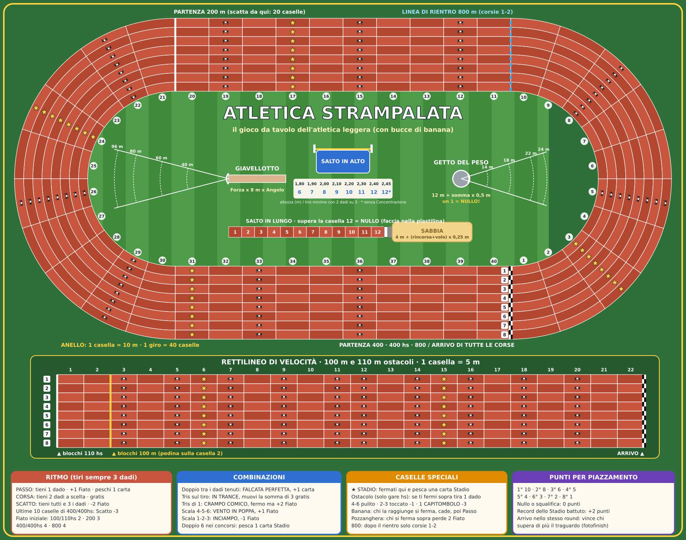

# 🏃 ATLETICA STRAMPALATA

**Il gioco da tavolo dell'atletica leggera — con dadi, carte e bucce di banana.**
1-8 giocatori · 8-100 anni · da 10 minuti (gara secca) a 2 ore (decathlon)

## Le 10 discipline

| Corse (sull'anello o sul rettilineo) | Concorsi (sul campo) |
|---|---|
| 100 m · 200 m · 400 m · 800 m | Salto in lungo · Salto in alto |
| 110 m ostacoli · 400 m ostacoli | Getto del peso · Lancio del giavellotto |

## Il gioco in 30 secondi

- **Tiri sempre 3 dadi, ma scegli quali tenere.** Al *Passo* ne tieni 1 (e recuperi Fiato e peschi una carta), di *Corsa* 2, in *Scatto* tutti e 3 (ma costa Fiato). Così decidi dove atterrare: evitare un ostacolo, prendere una stella, fare un doppio.
- **Combinazioni di dadi**: il doppio tenuto è una *Falcata Perfetta* (peschi una carta), il tris è *In Trance*, il tris di 1 un *Crampo Comico*, la scala 1-2-3 un *Inciampo*…
- **Il Fiato è poco**: quando scatti? Nei 400 m l'acido lattico rende lo scatto finale più caro, negli 800 m conta stare in scia.
- **Concorsi "rischia o fermati"**: nel lungo spingi la rincorsa senza superare l'asse, nel peso scegli quante rotazioni (dadi) fare sapendo che un 1 è nullo, nel giavellotto dividi i dadi tra Forza e Angolo, nell'alto decidi quali altezze passare.
- **Carte Scarpetta** per aiutarti (*Scarpe a Molla*, *Calzino Portafortuna*…), per fare dispetti (*Buccia di Banana*, *Megafono Sbagliato*, *Piccione Ladro*…) o per difenderti (*Occhio di Falco*, *Specchio Riflettente*).
- **Carte Stadio** e **Meteo** per imprevisti e condizioni di gara: la mascotte che ti abbraccia, il fotografo, il cane invasore, l'acquazzone.

## Modalità

Gara secca · Meeting (2-5 discipline) · **Decathlon** (tutti in tutte e 10, con i gettoni Grinta da dosare) · **A squadre** (mercato delle discipline e allenatori a bordo pista) · Solitario contro i Record dello Stadio · Variante Junior e Nonni & Nipoti.

## File

| File | Contenuto |
|---|---|
| [`REGOLAMENTO.md`](REGOLAMENTO.md) | Regolamento completo, modalità, personaggi, strategia, scheda segnapunti |
| [`CARTE.md`](CARTE.md) | Tutte le 84 carte (Scarpetta, Stadio, Meteo) con effetti e testi |
| [`plancia.svg`](plancia.svg) | La plancia stampabile (1800 × 1420, vettoriale: si stampa in qualunque formato) |
| [`strumenti/genera_plancia.py`](strumenti/genera_plancia.py) | Script che rigenera la plancia (`python3 strumenti/genera_plancia.py`) |
